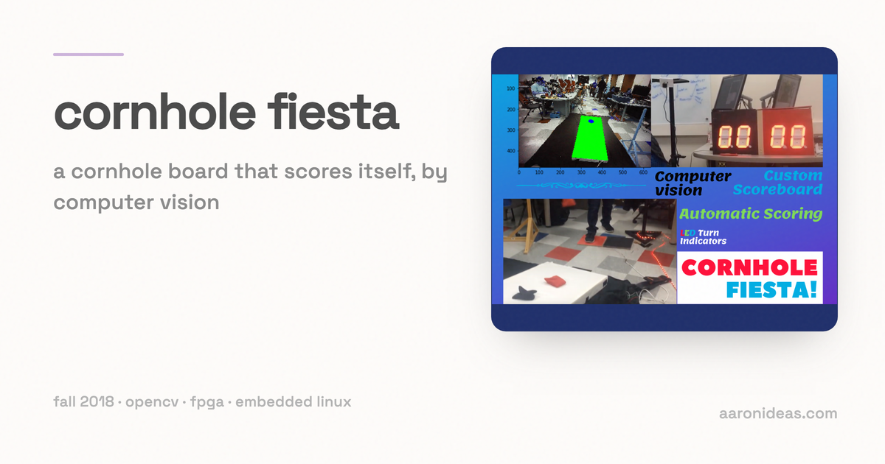

# Cornhole Fiesta

*A cornhole board that keeps score by itself.*

Cornhole is a game that keeps getting more popular. For our semester-long senior design project at UW-Madison (fall 2018) we built a version that scores itself, so nobody has to argue about the count.

The board runs on an Altera DE1-SoC, which carries an ARM Linux environment and an FPGA on one chip. Around it we added three custom circuit boards, computer vision, handmade load cells, and a Rock Band foot pedal.

[Watch the demo on YouTube](https://www.youtube.com/watch?v=lvDwlg9e8nA)

## How it works

- Each team has a footplate made from handmade load cells. Stepping on it says "I am throwing now" and opens a three-second scoring window for that team.
- A bag through the hole breaks a sensor. If the break lands inside the window, that team gets three points.
- When the window closes, the Linux app shells out to a Python 3 OpenCV script to count the bags that stayed on the board but missed the hole. Cornhole scoring is differential, so the two teams' totals are netted before they reach the display.
- The Rock Band pedal is the game controller. A long press toggles between play mode and edit mode. In edit mode a footplate picks the team, a single press adds a point, and a double press takes one away, which is how you fix a bad read.
- A microcontroller collects every footplate, hole, and pedal event and sends it to the Linux side over an XBee radio link. The Linux app answers over the same link with the LED colour for whose turn it is, and drives four seven-segment digits for the two scores.

## Project structure

- `opencv/` — the computer vision work, in Python 3.7 with OpenCV. `cornhole.py` is the pipeline: Canny edges, largest four-sided contour, then a four-point perspective transform to flatten the board into a top-down view. The notebooks (`cornhole.ipynb`, `Demo.ipynb`, `harris.ipynb`) are the exploratory versions, along with the test images used to tune them.
- `linux/` — everything that runs on the DE1-SoC. `apps/cornhole/` is the game itself; `apps/drivers/` and `apps/include/` hold the XBee, seven-segment, accelerometer, and temperature-sensor drivers; `kernel/ece453/` is the kernel module for the custom board. Each app cross-compiles with `arm-linux-gnueabihf-gcc` through its own Makefile.
- `web/` — a Flask page (`server.py`, port 8080 through `start.sh`) that draws a tournament bracket and scans QR codes from the device camera.
- `newtestpics/` — extra board photos captured for testing the vision code.

## Web dependencies

- [jQuery 1.6.2](https://blog.jquery.com/2011/06/30/jquery-162-released/)
- [jQuery Bracket](http://www.aropupu.fi/bracket/)
- [instascan](https://github.com/schmich/instascan)
- [ngrok](https://ngrok.com/download)

## Status

This is coursework, frozen at the end of the semester. The vision code assumes the camera and the lighting we had in the lab, and the web page was still a work in progress when we demoed the board.
